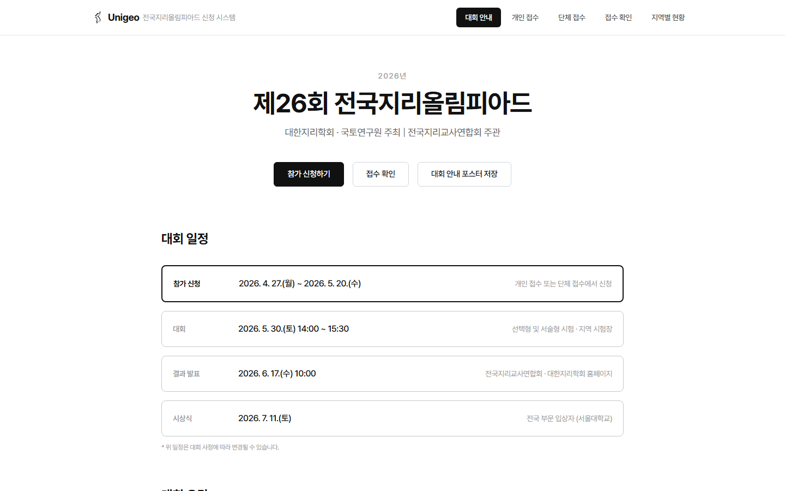

# Unigeo 전국지리올림피아드 신청 시스템 (geoolympiad.kr)

전국지리올림피아드(대한지리학회, 국토연구원 주최, 전국지리교사연합회 주관)의 참가 신청과 접수 관리를 맡는 웹사이트입니다. 고등학생은 개인으로, 지도교사는 학교 단체로 신청하고, 운영진은 입금 확인부터 수험번호, 수험표, 사진 명렬표까지 관리자 화면에서 처리합니다. 2026년 제26회 대회 접수에 썼습니다.

바로가기: https://geoolympiad.kr (같은 사이트: https://geolgo.vercel.app)



## 할 수 있는 일

### 참가자 화면

- **대회 안내** (`/`): 대회 일정, 대회 요강, 지역별 문의처를 보여 줍니다. 「대회 안내 포스터 저장」으로 관리자가 올린 포스터 PDF를 받습니다. 내용은 관리자 화면에서 고칩니다.
- **개인 접수** (`/register/individual`): 이름, 학교, 학년, 반, 지역, 연락처, 생년월일, 지도교사 정보를 넣고 증명사진을 올립니다. 사진은 화면에서 자르고 돌릴 수 있고, 올리기 전에 크기를 줄입니다. 신청이 끝나면 참가비 입금 안내가 뜹니다.
- **단체 접수** (`/register/group`): 지도교사가 학생 여러 명을 한 번에 신청합니다. 학생 명단은 CSV 양식으로 한꺼번에 넣고, 사진도 학생 이름에 맞춰 한꺼번에 올립니다(가운데 자동 자르기, 같은 이름 충돌 해결 창 포함). 참가비 합계는 저절로 계산됩니다.
- **접수 확인** (`/check`): 이름, 생년월일, 전화번호로 내 접수와 입금 상태를 확인합니다. 입금이 확인되면 수험표 PDF를 받습니다.
- **지역별 현황** (`/stats`): 17개 시도별 신청자 수와 고등학생 1만 명당 신청자 수를 단계구분도와 막대그래프로 보여 줍니다. 지도에는 방위표, 축척, 위경도 격자, 독도 표시가 있고, 지역을 누르면 아래 표의 같은 줄이 강조됩니다.
- **중복 신청 막기**: 이름, 생년월일, 전화번호가 모두 같은 신청이 이미 있으면 안내하고 막습니다. 이름과 전화번호의 공백과 보이지 않는 문자는 저장 전에 정리합니다.

### 관리자 화면 (`/admin`)

비밀번호로 들어가며, 모든 메뉴를 쓰는 관리자 권한과 대시보드, 지역별 현황만 보는 조회 전용 권한 두 가지가 있습니다.

- **대시보드**: 총 신청자, 입금 확인과 대기, 개인과 단체 수, 금액 요약, 지역별 현황, 24시간 안의 최근 신청을 보여 줍니다.
- **지역별 대시보드**: 시도별 신청자, 입금 확인, 입금 대기 수와 지역별 상세 명단을 봅니다.
- **참가자 관리**: 전체, 입금 대기, 입금 확인, 휴지통, 신청 취소로 나눠 보고, 이름, 학교, 지역, 지도교사로 찾습니다. 입금 확인은 한 명씩 또는 여러 명을 골라 한꺼번에 합니다. 참가자 정보와 지도교사 정보를 고치면 수정 이력이 남습니다.
- **엑셀 내려받기**: 전체, 대기, 확인, 휴지통, 신청 취소 명단을 수험번호와 지도교사 정보까지 넣어 받습니다.
- **수험표와 사진 명렬표**: 지역별 시험장을 정해 두면 입금 확인된 참가자의 수험표 PDF와 지역별 사진 명렬표 PDF를 만듭니다.
- **휴지통과 신청 취소**: 지운 신청은 휴지통으로 가고 복구하거나 영구 삭제합니다. 신청 취소는 환불 명단 관리용입니다.
- **대회 안내 관리**: 첫 화면의 일정, 요강, 문의처, 포스터 PDF를 고치면 바로 반영됩니다.
- **Supabase 사용량**: 무료 요금제 한도와 견주어 사진 저장 용량, 표별 행 수를 재고, 대시보드에서 옮겨 적은 참고값과 함께 보여 줍니다.

## 수험번호

수험번호는 8자리 `11` + 분반(2자리) + 분반 안 번호(2자리) + 지역번호(2자리)입니다. 지역마다 신청한 순서대로 매기고, 한 분반은 70명까지입니다. 휴지통이나 신청 취소에 들어간 신청은 번호를 받지 않아 빈 자리는 다음 사람이 채우고, 휴지통에서 복구한 신청은 맨 뒤 번호를 받아 다른 사람 번호가 밀리지 않습니다. 자세한 규칙은 `src/lib/examNumber.ts`와 `UNIGEO_DOCUMENTATION.md`에 있습니다.

## 쓰는 기술

- Next.js 16(App Router), React 19, TypeScript, Tailwind CSS 4
- Supabase: PostgreSQL 표(`registrations`, `groups`, `exam_locations`, `edit_logs`, `page_content`)와 사진 저장소(`photos` 버킷). 표 구조와 접근 정책은 `supabase_schema.sql`에 있습니다.
- 지도와 그래프는 ECharts, 엑셀은 SheetJS(`xlsx`), PDF는 jsPDF, 사진 자르기는 react-easy-crop
- 대시보드와 지역별 현황은 일정 간격으로 다시 불러옵니다(데이터베이스 부담을 줄이려고 실시간 구독 대신 씀).
- 글꼴은 Pretendard, 배포는 Vercel입니다.

## 실행하기

```
npm install
npm run dev       # 개발 서버 (http://localhost:3000)
npm run build     # 배포용 빌드
npm run start     # 빌드한 것 실행
npm run lint      # ESLint 검사
```

`.env.local`에 아래 두 값을 넣습니다. Vercel에도 같은 이름으로 넣어야 합니다.

| 이름 | 쓰는 곳 |
|---|---|
| `NEXT_PUBLIC_SUPABASE_URL` | Supabase 프로젝트 주소 |
| `NEXT_PUBLIC_SUPABASE_ANON_KEY` | Supabase 공개 키 |

값을 넣지 않으면 연습용 가짜 자료(`src/lib/mockdata.ts`, 380건)로 화면이 돌아갑니다. 새 Supabase 프로젝트를 만들 때는 `supabase_schema.sql`을 실행하고 공개 `photos` 버킷을 만듭니다.

## 파일 구성

```
src/
  app/
    page.tsx                대회 안내 (첫 화면)
    register/individual/    개인 접수
    register/group/         단체 접수
    check/                  접수 확인과 수험표
    stats/                  지역별 신청 현황
    admin/
      layout.tsx            관리자 로그인과 권한
      dashboard/            대시보드
      regions/              지역별 대시보드와 지역 상세
      payments/             참가자 관리
      content/              대회 안내 관리
      usage/                Supabase 사용량
  components/
    Navigation.tsx, Footer.tsx
    ParticipantManager.tsx  참가자 관리 표와 창
    PhotoEditor.tsx         사진 자르기와 돌리기
    RegionMap.tsx           지역별 단계구분도
  lib/
    supabase.ts             Supabase 연결
    examNumber.ts           수험번호 계산
    examTicket.ts           수험표 PDF
    photoRoster.ts          사진 명렬표 PDF
    pdfFont.ts              PDF 한글 글꼴
    regions.ts              17개 시도와 고등학생 수
    pageContent.ts          대회 안내 내용 불러오기
    normalize.ts            이름, 전화번호 정리
    cropImage.ts, resizeImage.ts  사진 자르기와 줄이기
    mockdata.ts             연습용 가짜 자료
public/
  geo/korea_sido_final.geojson  시도 경계
  fonts/                    Pretendard
  KERIS.png, KGEO.png, KRIHS.svg, UNIGEO.png  아래쪽 기관 로고
supabase_schema.sql         데이터베이스 표와 정책
scripts/normalize-existing-names.sql  이미 저장된 이름, 전화번호 정리
mock_data/, mockdata.csv    단체 접수 시험용 CSV와 사진
UNIGEO_DOCUMENTATION.md     기능과 데이터 구조 상세 문서
CHANGELOG-2026-05-06.md     중복 신청 막기와 수험번호 빈 자리 채우기 변경 기록
```

## 자료 출처

- 시도별 고등학생 수(1만 명당 신청자 수 계산 기준): 교육통계서비스(KESS), 2025년 4월 1일 기준
- 글꼴: Pretendard (SIL Open Font License 1.1, `Pretendard-1.3.9/LICENSE.txt`)

## 만든 사람

양정고등학교 지리교사 김용현  
문의: bgnlkim@gmail.com
